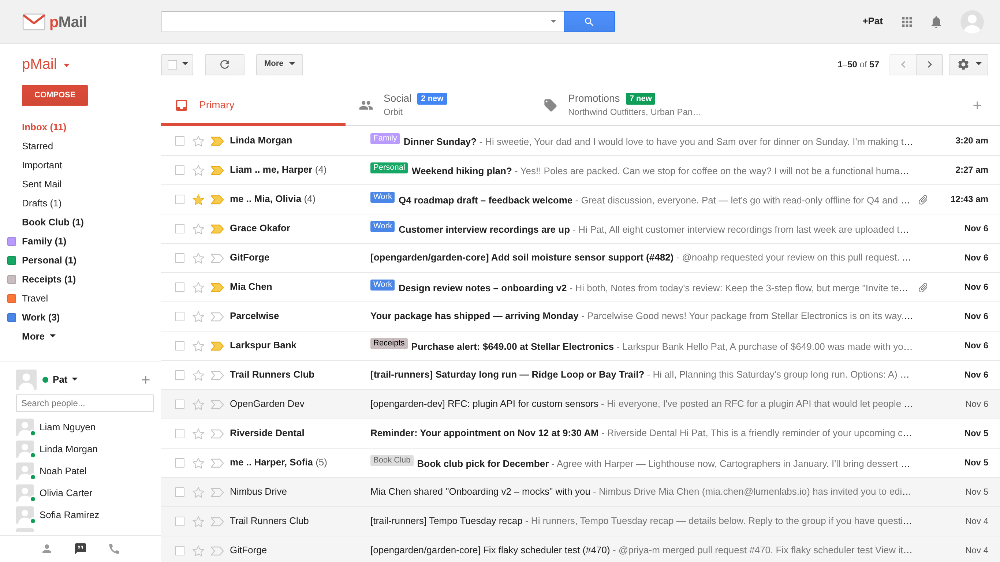

# pMail

**pMail** is a webmail client modeled on the *classic* Gmail interface (roughly 2013–2018): the light-gray top bar, the red **COMPOSE** button, label navigation with the chat roster underneath, inbox tabs, the yellow notification bar, docked compose windows, and the gear menu.

**▶ Live demo: https://miglisle.github.io/pMail/**



It runs entirely in your browser. There's no server, no build step and no dependencies. A demo mailbox of about 200 messages loads on first run, and everything you do (send, label, archive, filter, settings) is saved to `localStorage`.

> pMail is an independent project. It isn't affiliated with or endorsed by Google, and it uses its own name, logo and demo data. Every person, company and email address in the demo mailbox is fictional.

## Run it

Open `index.html` in a browser by double-clicking it. Or serve the folder:

```sh
python3 -m http.server 8000   # then visit http://localhost:8000
```

It works as-is on GitHub Pages or any static host.

## What's included

**Mailbox**
- Conversation view with threading, collapsed/expanded messages, an "N older messages" stack, trimmed quoted text (`···`), details popup, contact hover cards and **Show original**
- Conversation view on or off (each message on its own row)
- Inbox tabs (Primary, Social, Promotions, Updates, Forums) with "N new" badges, plus **Configure inbox**
- Inbox types: Default, Important first, Unread first, Starred first, Priority Inbox
- System labels (Inbox, Starred, Important, Chats, Sent Mail, Drafts, All Mail, Spam, Trash, Categories), each with show/hide/show-if-unread
- User labels: create, nest, rename, recolor (classic color palette), show/hide, remove
- Stars, importance markers, mute, report spam / not spam, delete / delete forever, Empty Trash / Spam
- **Move to ▾** and **Labels ▾** menus with search, tri-state checkboxes and "create new"
- Drag conversations onto labels or onto inbox tabs
- Select menu (All / None / Read / Unread / Starred / Unstarred), shift-click range select
- Pagination (`1–50 of N`) with Newest/Oldest sort, plus display density (Comfortable / Cozy / Compact)
- Undo for every action in the yellow notification bar, and `z` to undo the last one
- New mail arrives every few minutes (or when you click Refresh); the tab title shows the unread count

**Compose**
- Docked windows (several at once) that minimize, go full-screen and save & close
- Recipient chips with contact autocomplete, Cc/Bcc, and invalid-address errors
- Rich text: font, size, bold/italic/underline, colors, alignment, lists, indent, quote, strikethrough, remove formatting
- Attachments (click or drag & drop), inline photos, links, emoji, plain-text mode, print
- Drafts auto-save ("Saving…" / "Saved"), and Discard has an undo
- Inline Reply / Reply to all / Forward in the conversation, with pop-out and Edit subject
- **Undo Send** (5–30 s), the "no subject" and "forgot the attachment?" checks, signatures, and an optional Send + Archive button

**Search**
- Operators: `from:` `to:` `cc:` `bcc:` `subject:` `label:` `in:` (inbox, sent, drafts, spam, trash, anywhere) `is:` (unread, read, starred, important, muted) `has:attachment` `filename:` `category:` `after:` `before:` `older_than:` `newer_than:` `larger:` `smaller:`, plus `"phrases"`, `OR`, `-exclude`, `( )` and `{ }`
- Suggestions while you type, and the **Search options** panel
- **Create filter with this search**: skip inbox, mark read, star, apply label, delete, never spam, importance, categorize, and optionally apply to existing mail

**Settings**: General (page size, Undo Send, reply behavior, text style, conversation view, desktop notifications, keyboard shortcuts, button labels as icons or text, picture, signature, snippets, personal level indicators, vacation responder, reset/export data), Labels, Inbox, Accounts and Import, Filters and Blocked Addresses (with import/export), Forwarding and POP/IMAP, Chat, Labs (Auto-advance, Mark as Read button, Unread message icon), Offline, and Themes.

**Everything else**
- Themes: Light, Soft Gray, Dark, High Contrast and eight background themes
- Attachment viewer for images, PDFs and text, with download (demo attachments are generated on the fly as real files)
- Contacts manager (My Contacts, Starred, Most Contacted, Other Contacts) with CSV import/export
- Tasks window, and chat roster with chat windows
- Print / open-in-new-window view of a conversation
- Account menu, apps grid and sign-out screen

## Keyboard shortcuts

Shortcuts are on by default. Press `?` to see them all.

| Keys | Action | Keys | Action |
|---|---|---|---|
| `c` | Compose | `/` | Search |
| `j` / `k` | Older / newer conversation | `o` / `Enter` | Open |
| `u` | Back to list | `x` | Select |
| `e` | Archive | `#` | Delete |
| `!` | Report spam | `m` | Mute |
| `s` | Star | `+` / `-` | Mark important / not important |
| `r` / `a` / `f` | Reply / reply all / forward | `Shift+i` / `Shift+u` | Mark read / unread |
| `l` / `v` | Labels / Move to menu | `z` | Undo |
| `g` then `i` `s` `t` `d` `a` `c` `k` `l` | Go to Inbox, Starred, Sent, Drafts, All Mail, Contacts, Tasks, a label | `*` then `a` `n` `r` `u` `s` `t` | Select all, none, read, unread, starred, unstarred |
| `Ctrl+Enter` | Send (in compose) | `Esc` | Close |

## Project layout

```
index.html          app shell
css/pmail.css       all styles (classic look, themes, densities)
js/util.js          helpers (escaping, sanitizing, dates, storage, event bus)
js/icons.js         SVG icons and the pMail logo
js/seed.js          demo mailbox (fictional people and companies)
js/store.js         state, persistence, label-based mailbox model, filters, contacts, tasks
js/search.js        search query language
js/ui.js            menus, dialogs, notification bar, tooltips
js/app.js           routing, navigation, toolbar, actions, header
js/list.js          conversation list and inbox tabs
js/thread.js        conversation view
js/compose.js       compose windows, inline replies, undo send
js/searchui.js      search box, suggestions, search options, filter creation
js/settings.js      settings pages
js/contacts.js      contacts manager
js/chat.js          chat roster and chat windows
js/tasks.js         tasks window
js/shortcuts.js     keyboard shortcuts
js/attachments.js   attachment viewer and generated demo files
js/themes.js        themes
js/main.js          boot and simulated incoming mail
```

To start over with a fresh demo mailbox, use **Settings › General › Reset demo mailbox**.

Icon paths are adapted from Material Design Icons (Apache License 2.0).
